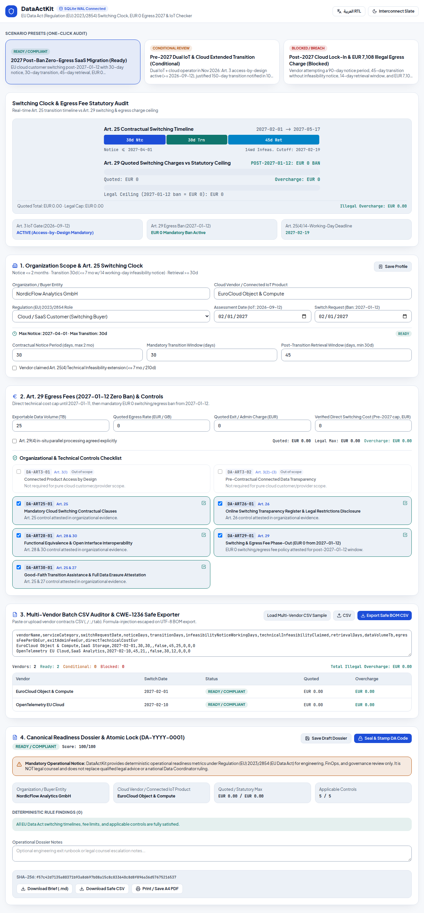
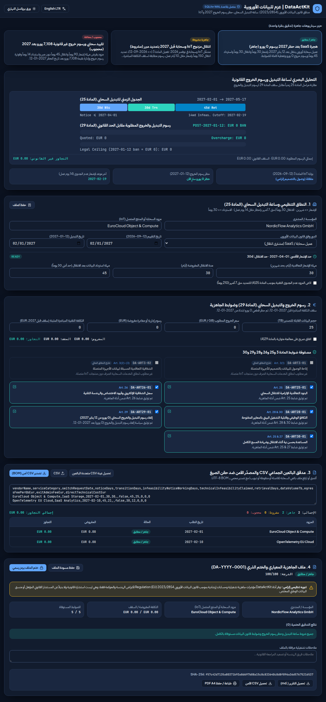
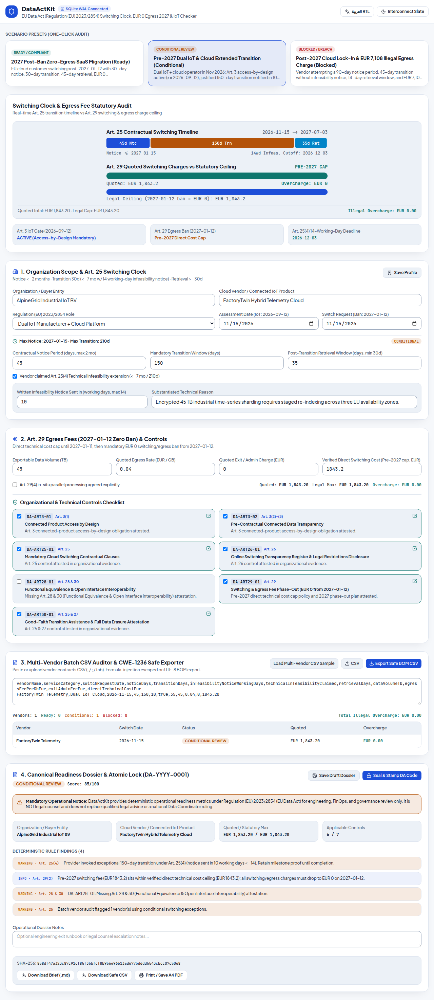
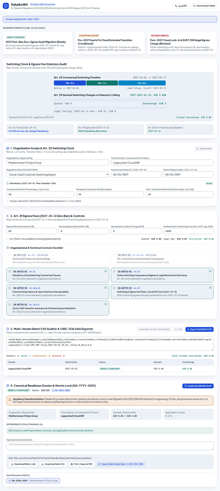
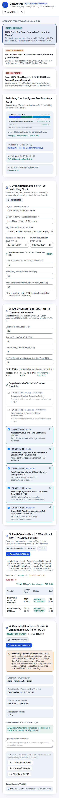
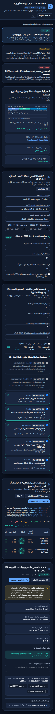

# DataActKit — EU Data Act (`Regulation (EU) 2023/2854`) Switching Clock, EUR 0 Egress 2027 & Connected IoT Checker

[](LICENSE)

> **English (`LTR`) & Arabic (`RTL`) · `Brussels Drafting Vellum` Light / `Interconnect Slate Night` Dark · Dual-Mode (`SQLite WAL` or `$0` Browser Static Mode)**

An open-source operational readiness workbench for the **EU Data Act (`Regulation (EU) 2023/2854`)** — auditing **Art. 25** cloud switching timelines, enforcing **Art. 29**'s mandatory **EUR 0 switching and egress fee ban effective `12 January 2027`**, activating **Art. 3** connected IoT **Access-by-Design (`12 September 2026`)**, and running multi-vendor `CSV` batch audits with formula-injection protection.

> **Mandatory Legal Disclaimer:** DataActKit provides deterministic operational readiness metrics, timeline calculations, and CSV fee audits under Regulation (EU) 2023/2854 for engineering, FinOps, and governance review only. It is **NOT** legal counsel and does **not** replace qualified legal advice or a national Data Coordinator ruling.

---

## Key EU Data Act Capabilities
- **Art. 25 Contractual Cloud Switching Clock**:
  - Enforces the **<= 2-month** customer notice period cap (`addMonthsUtc`).
  - Validates the mandatory **30-day standard transition** or **<= 7-month (`210d`) technical infeasibility extension** requiring substantiated justification and written provider notification within **<= 14 UTC working days**.
  - Checks the minimum **>= 30-day** post-transition data retrieval window.
- **Art. 29 Switching & Egress Fee Audit (`2027-01-12` EUR 0 Cutoff)**:
  - Before **`2027-01-12`**: limits charges strictly to verified direct technical switching costs.
  - On and after **`2027-01-12`**: enforces the mandatory **EUR 0 switching and data egress charge ban** and quantifies illegal overcharges (`EUR`).
- **Art. 3 Connected IoT Access-by-Design (`2026-09-12`) & Arts. 26/28/30 Controls**:
  - Dynamically toggles Art. 3 connected-product access-by-design and pre-contractual data transparency obligations starting `2026-09-12`, alongside cloud switching contract, online register, functional-equivalence interoperability, and verified erasure controls.
- **Multi-Vendor Batch CSV Auditor & CWE-1236 Safe Exporter**:
  - Parses `,`, `;`, or tab-delimited vendor schedules, flags overcharges/deadline breaches row-by-row, and exports **`UTF-8 BOM`** CSVs with spreadsheet formula-injection neutralization.
- **Canonical Dossiers & Bilingual UI (`EN LTR` / `AR RTL`)**:
  - Dual-mode persistence (`Node 22 + node:sqlite WAL` or `$0` browser `localStorage`), atomic immutable `DA-YYYY-0001` sealing with Web Crypto `SHA-256`, shareable `/r/:slugOrCode` view, and **`A4 PDF`** print output.

---

## Visual Showcase (`EN LTR` & `AR RTL`)

### Desktop English LTR (`Brussels Drafting Vellum` — 2027 Zero Egress Ready)


### Desktop Arabic RTL (`Interconnect Slate Night` Dark)


### Pre-2027 Dual IoT & Cloud Extended Transition (`Art. 3` Active `>= 2026-09-12`)


### Sealed Dossier (`DA-2026-0001`, Remediated Lock-In & Share Route `/r/DA-2026-0001`)


### Mobile English LTR View (`390x844`)


### Mobile Arabic RTL View (`Interconnect Slate Night`, `390x844`)


---

## Quick Start (`$0` Self-Hosted or Static)

```bash
npm ci
npm run typecheck
npm test        # Core & Node 22 SQLite WAL server tests
npm run build   # Builds static bundle into ./dist
npm start       # Serves API + React UI on http://127.0.0.1:4217
```

### Zero-Server Static Deploy (`$0` Cloudflare Workers Static Assets)
```bash
npm run build
npx wrangler deploy
```
When deployed without a backend (`./dist` only), DataActKit automatically runs in **`$0 Local Browser Mode`** backed by `localStorage` and Web Crypto `SHA-256`.

### Playwright Chrome E2E Verification
```bash
npm run test:e2e
```

---

## License

Released under the [MIT License](LICENSE).
